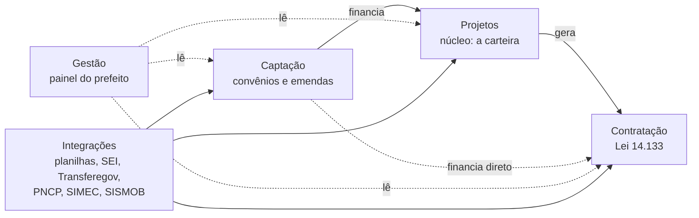
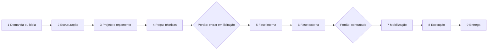
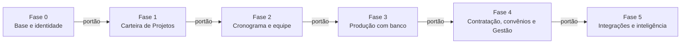

# GovNexa — Planejamento do Sistema (v1)

> **Plano oficial do GovNexa, versionado no repositório para toda a equipe.** Versão inicial de 15/11/2026; a seção "Andamento" é atualizada a cada entrega (regra no `CLAUDE.md`).
> O resumo para quem chega está no `README.md`. Este documento é o detalhe: atores, módulos, regras, prazos, integrações, segurança, roteiro, riscos e rastreabilidade.
> Pessoas são citadas só por papel; nenhum dado pessoal entra aqui.

## Andamento · última atualização em 16/11/2026, 16h43

O sistema está no ar com os dados reais da planilha (334 projetos e 13 cronogramas do GEPP); gravação de alterações depende do banco de dados. O que mudou em cada entrega está em `docs/CHANGELOG.md`.

| Fase | O que entrega | Situação | % |
| --- | --- | --- | --- |
| Planejamento | Plano, decisões, rastreabilidade, Fluxo, fluxos detalhados, mapa de impacto | Fluxos detalhados e mapa de impacto publicados; caixas do Fluxo cabem na raia; zoom no Fluxo | 97% |
| 0 · Base e identidade | Marca GovNexa, menu por módulos, tema estável, paginação compacta | Publicada; menu lateral com blocos que abrem e fecham (começam fechados) | 100% |
| 1 · Carteira de Projetos | Carga real, Carteira, ficha, Kanban, Gantt, Visão por órgão, celular | Publicada com dados reais | 100% |
| 1.5 · Cadastro, movimentação, log, sala de guerra | Novo projeto, Kanban e Pendências (simulação), Histórico, Sala de guerra | Publicada em simulação (Novo projeto no ar, fora do menu lateral); gravar depende do banco | 95% |
| 2 · Cronograma e equipe | Cronogramas, quadro de tarefas, Onde está parado | Publicada com a Reunião semanal e as dependências entre etapas (atraso em cascata); leitura do SEI em simulação (a leitura diária depende do banco) | 90% |
| 3 · Produção com banco | PostgreSQL, perfis, isolamento por prefeitura | Preparada (tabelas e carga testadas); aguarda o banco na Vercel | 30% |
| 4 · Contratação, convênios e Gestão | Lei 14.133, cláusula suspensiva, alertas, painel do prefeito | Em construção: Prazos da Lei 14.133, Painel do prefeito, Mapa das obras e Central de alertas publicados; Licitação em detalhe com as datas reais do SEI em simulação; falta a leitura automática (banco) e o PNCP | 75% |
| 5 · Integrações e inteligência | PNCP, SIMEC, SISMOB, preços, WhatsApp, IA | Em construção: WhatsApp em simulação (permissão por número, relatório, perguntas e modelos para a Meta); envio real depende do banco e da conta do WhatsApp Business | 10% |

**Entregas (mais recentes primeiro)**

| Data | Entrega | PR |
| --- | --- | --- |
| 16/11 | README completo no repositório (história, princípios, roteiro, situação, funcionalidades, decisões, pendências) e regra no CLAUDE.md: toda entrega atualiza o README (publicado) | #46, #47 |
| 16/11 | Licitação em detalhe (simulação): fases da Lei 14.133 com as datas reais do SEI a partir da página salva, fase atual, duração, prazo de publicidade e projeto da carteira (publicado) | #45 |
| 16/11 | Fluxo: zoom (diminuir, aumentar, ajustar à tela; padrão menor em telas largas) e legenda recolhida (publicado) | #44 |
| 16/11 | Processos no SEI em simulação (leitor da página pública, documentos-chave, etapa sugerida, onde está e há quantos dias; links por projeto); caixas do Fluxo na largura da raia; menu com blocos fechados (publicado) | #43 |
| 16/11 | Dependências entre etapas e atraso em cascata; Central de alertas (Gestão › Alertas); modelos do WhatsApp para a Meta; lista de obras sem localização (publicado) | #42 |
| 15/11 | WhatsApp da Gestão: números autorizados, permissão por número, relatório automático e prévia de perguntas (simulação; publicado) | #41 |
| 15/11 | Correção: mapa em branco no site (arquivo do build que a Vercel não servia) (publicado) | #40 |
| 15/11 | Mapa das obras no painel do prefeito; Localização e fotos (ponto ou ruas e trechos, em simulação); migração 004 preparada (publicado) | #39 |
| 15/11 | Correção: religa o Painel do prefeito, perdido na junção do #34 (publicado) | #38 |
| 15/11 | Testes do menu lateral no celular (publicado) | #37 |
| 15/11 | Menu lateral com blocos e sub-blocos que abrem e fecham (publicado) | #36 |
| 15/11 | Prazos da Lei 14.133: prazos legais, metas internas e cálculo em dias úteis (publicado) | #35 |
| 15/11 | Reunião semanal: pauta automática, decisões, ações e ata em PDF (publicado) | #34 |
| 15/11 | Painel do prefeito na guia Gestão (publicado) | #33 |
| 15/11 | Regras de trabalho no repositório (CLAUDE.md) (publicado) | #32 |
| 15/11 | Novo projeto fora do menu lateral (publicado) | #31 |
| 15/11 | Novo projeto, 6 fluxos detalhados com exceções, mapa de impacto, paginação compacta, Sala de guerra (incluir/retirar), correção do celular | #30 |
| 15/11 | Carga real da planilha, tabelas em cartões no celular, correção do tema, Sala de guerra | #27, #28 |
| 15/11 | Fluxo do sistema com exportação em PDF | #25, #26 |
| 15/11 | Histórico de alterações (log) | #24 |
| 15/11 | Cronogramas, Onde está parado, Pendências de etapa, Kanban com simulação, banco preparado | #23 |
| 15/11 | Tabelas sem rolagem, Início com resumo real | #21 |
| 15/11 | Carteira, Kanban, Gantt, Visão por órgão | #20 |
| 15/11 | Rede de segurança da publicação | #19 |
| 15/11 | Marca GovNexa e menu por módulos | #18 |

**Última atualização (16/11/2026, 16h43):** publicado o #42: dependências entre etapas com atraso em cascata, Central de alertas, modelos do WhatsApp para aprovação da Meta e lista de obras sem localização. Decidido em 16/11: manter a dependência deduzida pela ordem e pelas datas (opção A); a regra será revista quando o fluxo for validado com o cliente, com as dependências e os subprocessos. Reteste do link do SEI (09h07): links válidos, sem captcha. Publicado o #43: Processos no SEI em simulação, Fluxo legível e menu com blocos fechados. Publicado o #44: zoom no Fluxo e legenda recolhida. Publicados o #46 e o #47: README completo no repositório, com a regra de atualizá-lo em toda entrega. Publicado o #45: Licitação em detalhe. Próximo: leitura do SEI por PDF.

**Depende do dono:** banco de dados na Vercel (dono da conta); gancho de publicação (VERCEL\_DEPLOY\_HOOK); validação do Fluxo com as áreas.

## 1. Sumário executivo

O GovNexa — Inteligência para a gestão pública — será a base única da carteira de projetos da Prefeitura de Goiânia, do desejo do gestor à obra entregue. Ele substitui a planilha de obras prioritárias e conecta captação de recursos, contratação (Lei 14.133/2021) e o painel do prefeito.

**Problema.** Hoje a carteira (cerca de 400 projetos) vive em planilhas editadas à mão. Cronogramas por obra ficam em abas separadas e painéis são montados manualmente a cada semana. Ninguém responde de imediato: onde está parado, com quem, há quantos dias, e quanto do orçamento não tem fonte.

**Visão.** Um projeto é cadastrado uma vez e todas as telas são visões dele: carteira, Kanban, Gantt, captação, licitação e painel. O sistema calcula status, prazos e alertas; a equipe só registra fatos (iniciou, concluiu, enviou, voltou).

**Princípios do plano**

- **Uma fonte da verdade:** o projeto é único; módulos independentes se ligam a ele por referência.
- **Calcular, não digitar:** status, %, farol, entrega projetada, saldo sem fonte e economia saem de regras.
- **Dado ausente não é zero:** fica "—" e entra em pendências de dado.
- **Toda espera tem dono:** etapa parada mostra quem deve o quê e desde quando.
- **Simples para quem usa:** fichas em texto, sem barra de rolagem lateral, poucos cliques; a equipe tem dificuldade com planilha e IA.
- **Origem preservada:** todo dado guarda fonte, data e o valor original importado.
- **Gestão leve:** PMBOK para marcos, linha de base e caminho crítico; execução ágil em Kanban.

**Decisões já tomadas**

**Escopo de produto.** A Prefeitura de Goiânia é o piloto; depois o GovNexa será comercializado para outras prefeituras, cada uma com acesso e dados próprios e isolados (seção 11.5).

| Tema | Decisão |
| --- | --- |
| Nome | GovNexa — Inteligência para a gestão pública |
| Organização | Módulos independentes e integrados: Projetos (núcleo), Captação, Contratação/Licitações e a guia Gestão |
| Licitações (guias atuais) | Operação, Planejamento, Preços, Automação, Mercado e Cadastros ficam por ora; serão reavaliadas |
| Guia Projetos da Captação | Continua na Captação (parecer de elegibilidade) e referencia o módulo Projetos |
| Painel do prefeito | Guia Gestão, que reúne todos os módulos ativos |
| Primeira entrega | Carteira de Projetos (substituir a planilha) |
| Dados | Planejado para PostgreSQL; o MVP roda em JSON até a produção |
| IA | Fora do MVP; prevista em fase posterior |
| Texto "Área de comprador" | Sai da página |
| Privacidade | Nenhum nome de pessoa em código, documentos ou repositório; referências por papel |

## 2. Atores e perfis de uso

Seis perfis cobrem todos os usos; no MVP haverá um único usuário com acesso total (decisão já tomada), e os perfis entram com o banco de dados.

| Perfil | Quem é | O que precisa ver | O que faz no sistema |
| --- | --- | --- | --- |
| Prefeito / Gabinete | Decisor de governo | Foto atual de cada projeto, licitações em curso (empresa, colocação, valor), medições, previsões de entrega | Consulta; recebe notificações (fase futura: WhatsApp) |
| Gestor de portfólio (GEPP/SECAP) | Coordena a carteira e a reunião semanal | Tudo, com farol e o que mudou na semana | Cadastra e prioriza projetos, distribui responsáveis, conduz a reunião, força portão de fase com justificativa |
| Responsável / técnico | Engenheiro, arquiteto, analista | Suas tarefas, prazos e bloqueios | Registra início, conclusão, envio e retorno de etapas; anexa documentos |
| Equipe de captação | Busca e acompanha recursos federais | Oportunidades, convênios, cláusulas suspensivas, prazos | Liga projeto a oportunidade, registra proposta e convênio |
| Equipe de contratação / agente de contratação | Conduz a licitação (Lei 14.133) | Funil de licitações, prazos legais, colocados | Registra publicação, sessão, propostas, habilitação, recursos e homologação |
| Secretaria parceira / órgão externo | SMS, SME, SEINFRA, PGM e outros | Itens do seu órgão e o que está com ele | Atualiza as pendências que lhe cabem (fase com perfis) |
|  |  |  |  |

**Regra de uso.** O sistema é desenhado para quem tem dificuldade com planilha: fichas em texto, campos essenciais na primeira tela, botões de ação rápida (Iniciar, Concluir, Enviar ao órgão, Registrar retorno, Abrir bloqueio) e nenhuma barra de rolagem lateral.

**Carga de trabalho sem punição.** A medição por pessoa serve para redistribuir demanda, nunca para avaliar desempenho. O painel mostra tarefas abertas e dias acumulados por pessoa; horas de trabalho entram em fase posterior.

## 3. Mapa de módulos

O projeto da carteira é o elo comum: a Captação financia projetos, os projetos geram contratações, e a guia Gestão lê a foto atual de todos. Cada módulo funciona sozinho; quando dois estão ativos, conversam por referência ao projeto.



Um convênio da Captação também pode financiar diretamente uma ou várias contratações, e uma contratação pode existir sem convênio (recurso próprio). Cada módulo declara se está ativo e o que expõe à guia Gestão.

| Módulo | Pergunta que responde | Liga-se a |
| --- | --- | --- |
| Projetos | O que vamos fazer, em que etapa está, com quem e quando entrega? | Todos |
| Captação | De onde vem o dinheiro e que prazos de convênio corremos? | Projeto, Contratação |
| Contratação | Como está cada licitação e cada contrato? | Projeto, Convênio |
| Gestão | Como está tudo, agora, em uma tela? | Lê todos os ativos |

## 4. Ciclo de vida do projeto

Todo projeto percorre as mesmas nove macroetapas, com os nomes padronizados da planilha geral e uma data final prevista para cada uma. Dentro de cada macroetapa ficam as etapas do modelo de cronograma, cada uma com dono, prazo e predecessoras.

**Decisão de 15/11/2026: o sistema usa os 7 nomes de macroetapa da planilha (aba PIPELINE).** O diagrama abaixo detalha o mesmo ciclo em 9 passos; a correspondência é:

| Macroetapa oficial (planilha) | Passos do diagrama |
| --- | --- |
| 00 – Em estruturação | 1 Demanda ou ideia · 2 Estruturação |
| 01 – Planejamento | 3 Projeto e orçamento · 4 Peças técnicas |
| 02 – Preparatório para Contratação | 5 Fase interna |
| 03 – Contratação | 6 Fase externa |
| 04 – Mobilização | 7 Mobilização |
| 05 – Execução | 8 Execução |
| 06 – Conclusão | 9 Entrega |

A carteira oficial é a aba PIPELINE (334 projetos, 16 órgãos), completada pela BASE\_OPERACIONAL (116 obras da SEINFRA: situação, reunião, providências, cronograma físico e financeiro, rateio regional), casadas por SEI e nome.



Os passos 5 e 6 pertencem ao módulo Contratação. Os portões estão na seção 9.6.

As etapas 5 e 6 (destacadas) pertencem ao módulo Contratação; as demais, ao módulo Projetos. Quando o cronograma detalhado existe, a macroetapa deixa de ser digitada e passa a ser derivada da etapa ativa.

**Estados laterais (em qualquer macroetapa):** Condicionado (em espera de recurso) · Suspenso · Relicitar · Revogado · Cancelado · Fundido a outro projeto. Cada um exige justificativa.

**Correspondência com o que já se usa**

| Macroetapa GovNexa | Mapa mental | Relatório por órgão | Painel de licitações |
| --- | --- | --- | --- |
| 1 Demanda ou ideia, 2 Estruturação | Planejamento e estruturação | Estruturação | — |
| 3 Projeto e orçamento, 4 Peças técnicas | Planejamento e estruturação | Planejamento | Projetos e orçamentos em finalização; em elaboração de peças técnicas |
| 5 Fase interna | Fase interna de contratação | Contratação | Editais em ajustes finais |
| 6 Fase externa | Fase externa de contratação | Contratação | Publicadas; em julgamento |
| 7 Mobilização | Mobilização e execução | Contratação | Concluídas (homologada, contrato, OS) |
| 8 Execução, 9 Entrega | Mobilização e execução | Em execução | Concluídas (em execução) |

**Modelo de cronograma de saúde (base já detalhada pela equipe):** F1 Planejamento e projetos (regularização da área, licenciamento, procurações, projetos, aprovações externas, orçamento) · F2 Fase interna · F3 Fase externa · F4 Mobilização · F5 Execução · F6 Operacionalização (equipamentos, mobiliário, TI, CNES) · F7 Chamamento de organização social · F8 Entrega final. Fases F6 e F7 são opcionais e se aplicam a unidades que precisam operar.

## 5. Módulo Projetos (núcleo)

O módulo Projetos guarda a carteira inteira e é a primeira entrega: ele precisa reproduzir tudo o que a planilha de obras prioritárias faz, sem perder nenhuma função, antes de a planilha virar somente leitura.

**Princípio de funcionamento (reforçado pelo dono em 15/11/2026).** O projeto nasce no cadastro (pela carga inicial da planilha ou cadastrado no sistema, com os mesmos campos) e evolui com o tempo. Ele anda ou volta de etapa por qualquer caminho: arrastando o card no Kanban, pela própria ficha (registrando um novo passo), pela área de pendências (aprovando ou reprovando a etapa) ou por uma atualização vinda do SEI. Todos os caminhos passam pela mesma regra e pelo mesmo registro: a mudança vale na hora em todas as telas e fica no histórico (quem, quando, de onde veio e por quê).

**Log do ciclo de vida (pedido do dono em 15/11/2026).** Toda alteração no projeto, do cadastro à conclusão, gera um registro imutável: o que foi feito (mudança de etapa, campo alterado com valor anterior e novo, passo registrado, pendência aprovada ou reprovada, carga da planilha, atualização do SEI), por quem, data e hora, de onde veio e o motivo. Uma tela de log permite filtrar por período, projeto, pessoa, tipo de ação, origem e texto, e exportar o resultado; a ficha de cada projeto mostra o seu histórico.

**Sala de guerra (pedido do dono em 15/11/2026, metodologia PMI).** Missões (objetivo crítico com prazo) e crises (problema que ameaça o projeto) com a equipe reunida: candidatos sugeridos pelo sistema (prioridade alta com prazo vencido, cronograma em ritmo vermelho, etapa parada há mais de 30 dias, contratação com saldo sem fonte, entrega próxima em risco); cada sala com objetivo, prazo, responsável, equipe, cadência de reuniões, escalonamento (equipe, secretário, gabinete), quadro RAID (riscos, ações, problemas, decisões), pauta de reunião gerada automaticamente, marcos e, no encerramento, resultado e lições aprendidas. Tudo entra no histórico.

### 5.1 Hierarquia

Portfólio → Programa (opcional, ex.: "29 UBS") → Projeto → Macroetapa → Etapa (tarefa com dono) → Ciclo (cada ida e volta de uma mesma etapa).

### 5.2 Classificação do projeto (nova, vinda da reunião)

Dois eixos independentes, porque um projeto pode ser decidido e ainda assim buscar recurso federal:

| Eixo | Valores propostos | Para quê |
| --- | --- | --- |
| Compromisso de execução | **Decidido** (executa com ou sem recurso externo) · **Condicionado** (só executa se houver recurso externo; a aba "em espera") · **Ideia** (demanda ainda não avaliada) | Separar o que o governo vai fazer do que é desejo do gestor |
| Situação de recurso | Sem fonte · Tesouro · Financiamento · Convênio/repasse · Contrapartida de empreendedor · Misto | Alimentar a Captação e o alerta de saldo sem fonte |

Recomendação de nome para a aba dos desejos: **Banco de Projetos Condicionados** (alternativas: "Em espera", "Carteira de oportunidade"). Todo projeto entra no cadastro, inclusive os que já têm recurso federal, porque a base será usada na execução.

### 5.3 Ficha do projeto (campos essenciais na primeira tela)

Título e local · tipo de projeto · órgão demandante e executor · **onde está agora** (órgão/pessoa) · responsável e gerente · macroetapa atual e farol · valor estimado com selo de confiabilidade (orçado, projeto básico, paramétrico, estimativa) e data-base · fontes de recurso e saldo sem fonte · prioridade executiva (P0–P3) e "obra do prefeito" · entrega projetada × linha de base · processos SEI vinculados · compromisso de execução.

Abas da ficha: Resumo · Valores e recursos · Cronograma (Kanban/Gantt) · Captação (oportunidades e convênios ligados) · Contratações · SEI e documentos · Ações e pendências · Reuniões · Histórico · Origem do dado.

### 5.4 Cronograma, Kanban e Gantt

- **Modelos por tipo de obra:** o projeto nasce de um modelo (UPA, UBS, CMEI, escola, praça, pavimentação, ponte, drenagem, reforma, serviço). O modelo de saúde já existe nas planilhas do GEPP (8 fases, cerca de 70 etapas). Os demais se criam por cópia.
- **Dependências:** cada etapa declara predecessoras; mudar uma data reprograma as sucessoras na projeção, sem tocar na linha de base.
- **Gantt geral:** uma linha por projeto, barras por macroetapa, com previsto × projetado × real, losangos nos marcos e a linha "hoje".
- **Gantt do projeto:** etapas, caminho crítico destacado e setas de dependência.
- **Kanban da carteira:** projetos em colunas por macroetapa, com valor total no topo de cada coluna (pedido expresso da gestão).
- **Kanban de tarefas:** A fazer · Aguardando dependência · Em andamento · Aguardando órgão externo · Em validação · Bloqueado · Concluído. Visão multiprojeto: "tudo que está com a PGM".
- **Ciclos de retrabalho:** "2ª entrega" e "diligência" são ciclos da mesma etapa, com o tempo atribuído ao órgão que segurou o processo.

### 5.5 Responsáveis e carga de trabalho

- Toda etapa tem um dono (pessoa + unidade) e, quando parada, um "dono do bloqueio".
- Painel de carga: por pessoa, tarefas abertas, atrasadas, dias acumulados e projetos em que atua; destaque de quem está acima da média da equipe.
- Fase posterior: estimativa de horas por etapa e sugestão de quem tem capacidade para assumir um novo projeto.

### 5.6 Reunião semanal e ações

O modo Reunião percorre os projetos por prioridade ou farol, mostra o que mudou desde a semana anterior e registra discussão, decisão e ações (responsável e prazo). Substitui a coluna "Reunião dd-mm" e a coluna "Providências" da planilha. Ideias soltas do rodapé da planilha viram itens de um backlog de demandas, conversíveis em projeto.

## 6. Módulo Captação

A Captação já existe e funciona com dados reais (oportunidades, convênios, CAUC, alertas); o que muda é que ela passa a se ligar ao projeto da carteira e ganha o acompanhamento da cláusula suspensiva.

### 6.1 Projeto × oportunidade: duas bases, uma sugestão

- O sistema **sugere** pares projeto–oportunidade (por tema, tipo de obra, palavras-chave e valor); a equipe confirma ou descarta. Nunca afirma sozinho.
- Três sinais ficam visíveis: oportunidade sem projeto (pode valer criar um projeto dentro da janela do programa, que costuma ir de 5 dias a 2 meses), projeto sem oportunidade, e par sugerido.
- Projeto "condicionado" com oportunidade aberta vira destaque: é a chance de executá-lo.
- Casou e a proposta foi aprovada: nasce o **convênio** (ou termo fundo a fundo), ligado ao projeto.

### 6.2 Ficha do convênio (só o essencial, aberta expandida, em texto)

Concedente (ministério) · número e sistema de origem · objeto · valor global, repasse, contrapartida · empenho do concedente (dinheiro reservado pelo ministério, diferente do empenho da prefeitura para a construtora) · valores liberados e saldo a liberar · aditivos (prazo e valor) · vigência · cláusula suspensiva e prazo · projeto(s) e contratações ligados.

### 6.3 Cláusula suspensiva: o primeiro alerta

- O convênio é assinado, mas o dinheiro só é liberado depois de cumprida a exigência (projeto executivo, orçamento, licença ambiental, termo de referência, titularidade da área). Se o prazo vencer sem cumprimento, o convênio é extinto.
- Cada exigência vira uma tarefa com dono, ligada à etapa correspondente do cronograma do projeto (ex.: "licença ambiental" = etapa 1.2.2).
- Alertas a 90, 60, 30 e 15 dias do vencimento, e quando a etapa ligada atrasa a ponto de comprometer o prazo.
- Base normativa: Portaria Conjunta MGI/MF/CGU nº 33/2023 (art. 24 e seguintes) e alterações; o prazo máximo e as regras de prorrogação serão conferidos no texto oficial antes da implementação. O prazo efetivo de cada convênio vem do próprio instrumento.

### 6.4 Saldo sem fonte

Para cada projeto: orçamento atual − (repasses + contrapartida + outras fontes garantidas). Exemplo da reunião: obra de R$ 6 mi com R$ 3 mi de repasse e R$ 0,5 mi de contrapartida = **R$ 2,5 mi sem fonte**, alerta vermelho. Um convênio pode financiar várias contratações, e uma contratação pode não ter convênio (recurso próprio).

### 6.5 Fontes de convênio

| Fonte | Abrange | Acesso a dados | Plano |
| --- | --- | --- | --- |
| Transferegov | Convênios e contratos de repasse da maioria dos ministérios | Arquivos abertos e API pública (já em uso no sistema) | Manter; base principal |
| SIMEC (FNDE/MEC) | Obras de educação (PAR, Obras 2.0) | Sem API pública conhecida; o FNDE publica planilhas de obras em dados abertos, só com a situação atual e sem histórico | Importar a planilha aberta + cadastro manual assistido; validar o que o acesso municipal ao SIMEC permite exportar |
| SISMOB (Saúde) | Obras de saúde fundo a fundo (UBS, UPA etc.) | Sem API pública conhecida; acesso municipal com login; há indicação de integração futura ao Obrasgov.br | Cadastro manual assistido + importação de relatório exportado; avaliar os web services do Obrasgov.br |

Um convênio está em uma única fonte, nunca em duas. Fontes complementares já integradas seguem como contexto: CAUC, SICONFI, FNS, Portal da Transparência, IBGE, DOU, INEP, CNES e SINISA.

### 6.6 Elaboração de proposta com apoio de IA (fase posterior)

Preencher o formulário padrão do Transferegov (justificativa, benefício social, resultado esperado) com indicadores de Goiânia ligados ao tema; o usuário revisa tudo antes de usar. Fica fora do MVP por decisão já tomada; antes da IA, o sistema oferece modelos de texto e os indicadores já coletados.

## 7. Módulo Contratação (Lei 14.133/2021)

A Contratação acompanha cada processo licitatório do pedido à ordem de serviço, aplica os prazos da Lei 14.133 e mostra, a qualquer momento, quem está na frente, por quanto e o que falta. Ela substitui o painel de licitações montado à mão.

### 7.1 Relações

- Um projeto pode ter várias contratações (projeto, obra, supervisão, equipamentos).
- Uma licitação pode ter vários **lotes**, e cada lote pode atender um projeto diferente (ex.: 4 CMEIs numa licitação).
- Um convênio pode financiar várias contratações; uma contratação pode ser só com recurso próprio.
- Formas: licitação (pregão, concorrência), adesão a ata, dispensa, inexigibilidade, credenciamento, contrapartida de empreendedor (termo de compensação) e chamamento público (organização social).

### 7.2 Fase interna (preparatória, art. 18)

1. Projeto e orçamento (próprios, contratados ou recebidos por termo de compensação, com ART e aceite do engenheiro da prefeitura).
2. Peças técnicas: DFD, ETP, mapa de riscos, TR ou projeto básico, orçamento de referência (obras: SINAPI e tabelas oficiais, art. 23).
3. Autorização financeira (comitê de gastos / SEFAZ).
4. Minuta do edital a partir de **modelo por tipo** (toda escola usa o mesmo modelo, toda UPA também), preenchida com os dados do projeto.
5. Controle de legalidade pela PGM (art. 53), com diligências em ciclos.
6. Ajustes e despacho de autorização da fase externa.

### 7.3 Fase externa

1. Publicação: PNCP, Diário Oficial e jornal, respeitando o prazo mínimo de publicidade (art. 55).
2. Sessão, propostas e lances.
3. Julgamento: o sistema guarda a **ordem de classificação completa**, com empresa, CNPJ, valor e situação de cada uma.
4. Habilitação (técnica, econômica, fiscal) do primeiro colocado; inabilitado, chama-se o próximo. Cada tentativa fica registrada (já houve caso de chegar ao 7º colocado).
5. Recursos: intenção, razões, contrarrazões e decisão (art. 165).
6. Homologação e adjudicação.
7. Garantia (seguro-garantia, com cláusula de retomada quando aplicável), assinatura, publicação do contrato no PNCP e ordem de serviço.

### 7.4 Prazos legais que o sistema calcula (dias úteis)

| Momento | Regra | Referência |
| --- | --- | --- |
| Publicidade mínima: obras e serviços comuns de engenharia, menor preço | 10 dias úteis | art. 55, II, a |
| Publicidade mínima: obras e serviços especiais de engenharia | 25 dias úteis | art. 55, II, c |
| Publicidade mínima: contratação integrada / semi-integrada | 60 / 35 dias úteis | art. 55, II, d e III |
| Publicidade mínima: técnica e preço ou melhor técnica | 35 dias úteis | art. 55, III |
| Recurso e contrarrazões | 3 + 3 dias úteis | art. 165 |
| Decisão do recurso pela autoridade | até 10 dias úteis | art. 165, § 2º |
| Divulgação do contrato no PNCP (condição de eficácia) | 20 dias úteis (licitação) / 10 (contratação direta) | art. 94 |

**Prazo da lei × prazo da prefeitura.** A prefeitura define metas internas mais curtas que a lei, para ter folga diante de imprevistos. O sistema trata dois tipos de prazo legal de forma diferente:

- **Prazo máximo (teto)** — ex.: decisão de recurso, publicação do contrato no PNCP, cláusula suspensiva. A meta interna é menor; passou da meta = alerta amarelo; o planejado ou o real **ultrapassar o limite legal = alerta vermelho de destaque**, no topo do painel e para o gestor.
- **Prazo mínimo (piso)** — ex.: publicidade do edital (art. 55) e prazo para recurso. Aqui encurtar é ilegal: o sistema impede marcar a abertura antes do mínimo e alerta se o cronograma planejar menos. A folga interna vai nas etapas anteriores (edital pronto antes), nunca no prazo do licitante.

Todo prazo legal fica como parâmetro com sua referência na lei e é conferido no texto oficial antes da implementação. Para o PNCP, a lei dá 20 dias úteis em licitação; os 10 dias da especificação de cronograma ficam como meta interna.

### 7.5 Verificações automáticas

- **Proposta possivelmente inexequível:** em obras e serviços de engenharia, proposta abaixo de 75% do orçado (art. 59, § 4º) gera aviso.
- **Economia:** estimado − proposto (em julgamento) e estimado − contratado (concluído).
- **Aditivos:** soma de acréscimos acima de 25% do valor inicial (50% em reforma) gera bloqueio para revisão (art. 125).
- **Orçamento desatualizado:** data-base com mais de 12 meses na publicação.
- **Cláusula suspensiva aberta** no convênio que financia a contratação.

### 7.6 Os cinco alertas que a gestão pediu

1. Cláusula suspensiva (prazo de cumprimento).
2. Edital na praça (publicação prevista × real).
3. Homologação (prevista × real).
4. Início da obra (ordem de serviço).
5. Fim da obra (prazo contratual e aditivos).

### 7.7 Execução do contrato

Medições (data, % físico, valor medido, valor pago, situação do pagamento), gráfico de avanço físico × financeiro, aditivos como eventos que geram nova linha de base, e recebimento provisório e definitivo (art. 140).

### 7.8 Orçamento de obra

Obra se orça por tabela referencial oficial (SINAPI e GOINFRA), não por cotação de mercado. O sistema guarda o orçamento com a tabela e a data-base usadas; a integração com as tabelas para conferir preços é uma fase posterior. As guias atuais de Licitações (Preços, Mercado), focadas em cotação de itens, serão reavaliadas à luz disso.

## 8. Guia Gestão (painel do prefeito)

A guia Gestão mostra a foto atual de tudo o que está ativo em todos os módulos, com um clique para o histórico. Ela só lê; não tem cadastro próprio. Cada módulo ativo declara o que expõe a ela, e um módulo desligado simplesmente some do painel.

### 8.1 Blocos do painel

| Bloco | Conteúdo | Origem |
| --- | --- | --- |
| Carteira em números | Quantidade e valor total; por macroetapa, órgão, região, ano e fonte; obras do prefeito em destaque | Projetos |
| Kanban executivo | Projetos por fase, com valor global no topo de cada coluna | Projetos |
| Funil de licitações | Em preparação → ajustes finais → publicadas → em julgamento → concluídas, com quantidade, valor e economia | Contratação |
| Licitações em julgamento | Empresa à frente e sua colocação (1º ao 7º), valor da proposta, segunda colocada, fase recursal e próximo prazo | Contratação |
| Próximos marcos | Próximos 15 dias: envio à PGM, publicação, abertura, contrarrazões, OS | Todos |
| Onde está parado | Por órgão e por empresa: itens, dias acumulados, o mais antigo (ex.: "Aguardando PGM: 4") | Projetos + Contratação |
| Obras em execução | Avanço físico × financeiro, medições pagas e pendentes, previsão de entrega | Contratação |
| Previsões | Fim da licitação, início e entrega da obra, projetado × linha de base | Projetos |
| Recursos federais | Convênios ativos, saldo a liberar, cláusulas suspensivas a vencer, saldo sem fonte | Captação |

### 8.2 Regras do painel

- **Foto atual primeiro:** cada cartão mostra só o estado de hoje; o histórico (o que mudou, quando, quem) abre em um clique.
- **Todo número é clicável** e leva à lista que o compõe.
- **Conciliação visível:** total geral = soma dos projetos ativos = soma por região = soma por ano; divergência aparece como alerta, nunca é escondida.
- **Visão por órgão para impressão:** reproduz o conteúdo dos relatórios atuais (capa com totais, uma seção por órgão, obras por macroetapa da entrega mais próxima à mais distante, com fim das peças técnicas, fim da contratação, dias de obra e entrega) e o do painel de licitações, gerado pelo sistema em PDF.

### 8.3 Notificações (fase posterior)

- Resumo semanal automático por destinatário: gestores (por projeto), responsáveis (suas pendências) e órgãos (cobrança).
- Avisos de eventos: licitação aberta, colocado inabilitado, homologação, cláusula suspensiva a vencer, medição paga.
- WhatsApp com perguntas em linguagem simples ("quais obras de saúde estão em licitação?"). Exige canal oficial (API do WhatsApp Business), consentimento e regras de LGPD; o sistema prepara agora os eventos e o relatório de status que alimentam essa fase.

## 9. Regras de negócio, alertas e cálculos

O usuário registra fatos e o sistema deriva o resto; só três status são manuais (Paralisado, Cancelado, Bloqueado) e todos exigem justificativa.

### 9.1 Status da etapa (ordem de precedência)

1. Status manual preenchido → Paralisado, Cancelado ou Bloqueado.
2. Data de fim real → Concluído (100%, sempre).
3. Bloqueio aberto → Bloqueado ("aguardando órgão X há N dias").
4. Iniciada e hoje após o fim previsto → Atrasada.
5. Iniciada → Em andamento.
6. Não iniciada e hoje após o início previsto → Início atrasado.
7. Predecessora aberta → Aguardando dependência.
8. Demais casos → A fazer.

### 9.2 Percentuais, desempenho e farol

- Etapa: 0% ou 100%; só etapas longas (obra, aprovações externas) usam percentual informado.
- Fase e projeto: média ponderada pela duração prevista.
- Índice de desempenho de prazo (SPI) = realizado ÷ previsto até hoje: verde ≥ 0,95 · amarelo 0,85 a 0,95 · vermelho < 0,85.
- Farol do projeto: **vermelho** se houver ação vencida, pendência externa acima de 30 dias, entrega projetada vencida, SPI < 0,85 ou saldo sem fonte em projeto em contratação; **amarelo** se faltar dado obrigatório, valor desatualizado ou pendência de 15 a 30 dias; **verde** nos demais.
- Caminho crítico calculado; atraso em etapa crítica empurra a entrega projetada e o painel mostra quantos dias.

### 9.3 Datas

- Dias úteis com calendário de feriados nacionais, de Goiás e de Goiânia; cada etapa define se conta dias úteis ou corridos.
- Data vazia nunca entra em cálculo (acaba com os números negativos da planilha).
- Entrega projetada = fim da contratação + dias de obra, recalculada a cada mudança.
- Linha de base versionada: a primeira nasce ao aprovar o planejamento; cada nova versão exige motivo (aditivo, fato externo, replanejamento).

### 9.4 Valores

- Saldo sem fonte = orçamento atual − fontes garantidas.
- Economia = estimado − proposto ou contratado.
- Rateio por região soma 100%; é proibido lançar o valor integral em duas regiões (erro que inflou a planilha em R$ 773 mi).
- Previsão física e financeira por ano soma o valor do projeto (tolerância de R$ 1); sem distribuição, todo o valor vai ao ano previsto com o aviso "distribuição presumida".
- Valor de anteprojeto (2%, parametrizável) calculado, não digitado.

### 9.5 Priorização (pesos configuráveis)

```latex
\text{score} = 0{,}35\,P + 0{,}25\,M + 0{,}15\,(5 - C)\cdot 25 + 0{,}15\,R + 0{,}10\,E
```

P = prioridade executiva (P0 = 100 … P3 = 25); M = maturidade (1 ideia … 5 executivo com orçamento e TR, convertida para 20 a 100); C = complexidade (1 a 4); R = recurso garantido (sim 100, em estudo 50, não 0); E = obra do prefeito (100 ou 0). A gestão pode fixar uma ordem manual.

### 9.6 Portões de fase

- Entrar em licitação: maturidade ≥ 4, orçamento com data-base de até 12 meses, TR anexado, fonte de recurso definida e cláusula suspensiva resolvida (quando houver convênio).
- Entrar em contratado: homologação e valor homologado registrados.
- Reprovado no portão, o sistema mostra o que falta; o gestor pode forçar a passagem com justificativa, que fica no histórico.

### 9.7 Catálogo de alertas

| Alerta | Dispara quando | Vai para |
| --- | --- | --- |
| Cláusula suspensiva | 90, 60, 30 e 15 dias antes do vencimento | Captação, gestor, responsável da exigência |
| Edital na praça | Publicação prevista passou sem publicação | Contratação, gestor |
| Homologação | Data prevista passou | Contratação, gestor |
| Início da obra | Contrato assinado sem OS em 15 dias | Gestor, órgão executor |
| Fim da obra | 60 e 30 dias antes do fim contratual, e ao vencer | Gestor, fiscal |
| Saldo sem fonte | Projeto com orçamento maior que as fontes garantidas | Captação, gestor |
| Etapa parada | Bloqueio ou etapa externa acima de 15 dias | Responsável, gestor |
| Proposta inexequível | Proposta < 75% do orçado em obra | Contratação |
| Aditivo no limite | Acréscimos acima de 25% (50% em reforma) | Contratação, PGM |
| Dado defasado | Fonte, orçamento ou cadastro sem atualização no prazo esperado | Responsável pelo dado |
| Convênio sem desembolso | 180 dias sem liberação (regra já vigente) | Captação |

Os prazos dos alertas são parâmetros ajustáveis pela gestão.

## 10. Dados e integrações

A carteira começa pela importação das duas planilhas atuais, com relatório de conciliação; integrações externas entram em ordem de valor e de viabilidade, e nenhuma depende de contornar captcha ou login.

### 10.1 Importação das planilhas

| Planilha | O que traz | Regras de importação |
| --- | --- | --- |
| Obras prioritárias (9 abas) | Carteira, campos manuais, pipeline, cronograma físico-financeiro 2026–2029, rateio regional, painel | Dados brutos preservados; junção pelo número do item (ou SEI + título); "-" vira vazio, nunca zero; datas em formatos mistos normalizadas ou marcadas como ambíguas; linhas de total e células com erro ficam como "ignoradas" e entram na conciliação |
| Cronogramas GEPP (15 abas, uma por obra) | Etapas, responsáveis, datas previstas e reais | Uma aba = um projeto; etapas casadas com o modelo por semelhança de nome, com confirmação; repetições ("2ª entrega") viram ciclos; colunas calculadas são recalculadas |

- Reimportar o mesmo arquivo não duplica nada; um arquivo novo gera uma lista de diferenças para aprovação.
- **Conciliação obrigatória antes do corte:** a planilha soma R$ 2,53 bi na base e a soma regional chega a R$ 3,30 bi por um erro de rateio. A base oficial são as planilhas; os relatórios recebidos (por órgão e de licitações) são só exemplo de conteúdo e não entram na conciliação. O relatório de importação explica cada diferença item a item; nada é "corrigido" em silêncio.
- Nomes de pessoas nas colunas de providências são convertidos em responsáveis cadastrados; o repositório de código nunca recebe a planilha nem nomes.

### 10.2 SEI da Prefeitura de Goiânia

Situação verificada em 15/11/2026:

- Instância em `sei.goiania.go.gov.br` (versão 2.29, inferida dos arquivos da página).
- Existe **Pesquisa Pública** sem login (número do processo, texto, interessado, órgão, unidade, tipo, período), protegida por **captcha de imagem**.
- Não há API, serviço web ou dados abertos anunciados. O SEI tem um serviço web oficial (SOAP), mas ele só atende sistemas cadastrados pela administração do SEI e endereços de rede autorizados.

Caminhos, em ordem de prioridade (o objetivo é o máximo de automação com poucos cliques, sem contornar captcha):

1. **Importação de PDF (decidida; base do MVP).** O usuário gera no SEI o PDF do processo e arrasta para a ficha do projeto. O sistema lê o texto, identifica número, andamentos, datas, unidades e documentos (edital, parecer, ata, homologação, contrato, OS) e mostra as atualizações propostas; o usuário confirma com um clique. PDF escaneado sem texto exige reconhecimento de texto (fase posterior).
2. **Releitura automática do link público do processo (testada em 15/11/2026; recomendada).** A pesquisa pública do SEI gera, para cada processo, uma página de exibição com um código próprio. Teste com um processo de licitação da SEINFRA: depois de obtido, o link abriu sem captcha e trouxe tipo e data do processo, a lista de documentos (258: número, tipo, data e unidade) e a lista de andamentos (443: data, hora, unidade e descrição). O conteúdo dos documentos restritos não aparece, e o botão "Gerar PDF" pede captcha. Funcionamento: o usuário faz a pesquisa uma vez, cola o link na ficha, e o GovNexa relê a página uma vez por dia, um processo por vez. Com isso sabe onde o processo está, há quantos dias, e quando surge um documento-chave pelo tipo (edital, parecer, homologação, contrato), e propõe a atualização da etapa. Reteste em 16/11/2026, às 09h07, um dia depois: os dois links continuam válidos e abrem sem captcha. Processo da SEINFRA: 258 documentos e 443 andamentos, último em 21/01/2026. Processo da SECAP: 324 documentos e 50 andamentos, último em 12/11/2026; um documento público voltou como PDF direto. O link público pode ser guardado na ficha; se algum dia expirar, o GovNexa avisa e pede um link novo. O conteúdo do documento continua entrando por PDF (caminho 1).
3. **Botão "Enviar ao GovNexa" no navegador (a validar).** Para servidores já logados no SEI: um atalho no navegador lê a tela do processo aberta (andamentos e lista de documentos) e envia ao GovNexa em um clique. Alcança também processos restritos que o servidor já pode ver, sem guardar senha.
4. **Serviço web oficial do SEI (opcional, futuro).** Continua sendo a via mais estável, se a prefeitura quiser cadastrar o GovNexa.

**Regra decidida: documento público é automático, documento restrito entra por PDF.** Para cada processo vinculado, o GovNexa relê a página pública todo dia (andamentos e lista de documentos). Documento marcado como público tem o conteúdo lido automaticamente: confirmado em 15/11/2026 com um processo de licitação da SECAP (324 documentos públicos, 50 andamentos), em que o link de cada documento devolveu o PDF direto, sem captcha e com texto legível. A lista de tipos permite reconhecer cada peça do fluxo: DFD, ETP, matriz de risco, projeto básico, minutas, ART, licença ambiental, declarações de orçamento e despachos. O DFD cita o número de outro processo SEI (o do convênio), o que permite ligar automaticamente processo de contratação e convênio. Documento restrito aparece na lista com tipo, data e unidade, e a ficha mostra "conteúdo restrito: enviar PDF"; o usuário arrasta o PDF quando precisar do conteúdo. No processo testado, todos os documentos estavam restritos provisoriamente, para reclassificação do nível de acesso.

**Cuidados da leitura automática.** Documentos públicos trazem dados pessoais de servidores (nome, matrícula, e-mail, telefone). O GovNexa guarda só o necessário para a gestão (tipo, data, unidade, números de processo, valores e prazos) e mascara dados pessoais no texto armazenado. Para não sobrecarregar o SEI, baixa apenas documentos novos de tipos-chave, um de cada vez, com intervalo entre acessos. O link de cada processo ainda precisa ser confirmado como válido nos dias seguintes.

**O que outras soluções provavelmente fazem e o GovNexa não fará.** Ferramentas que "consultam o SEI" sem acordo com a TI costumam resolver o captcha com serviços automáticos ou rodar robôs com senha de usuário. Isso viola os termos de uso, pode fazer o SEI bloquear o endereço de rede da própria prefeitura, quebra a cada mudança de tela e é um risco jurídico e de reputação para um produto vendido a prefeituras.

Não se automatiza a pesquisa pública contornando o captcha: é vedado pela regra de segurança do projeto e frágil.

### 10.3 Outras integrações

| Integração | Uso | Quando |
| --- | --- | --- |
| PNCP (API pública) | Conferir publicação de editais, atas e contratos da prefeitura e trazer resultados | Fase de Contratação |
| Transferegov e fontes da Captação | Convênios, programas, alertas (já integradas) | Já em uso |
| SIMEC e SISMOB | Convênios de educação e saúde | Importação de relatório + cadastro assistido |
| SINAPI (Caixa) e GOINFRA | Tabelas referenciais de orçamento de obra | Fase posterior |
| Diário Oficial do Município | Confirmar publicações | Fase posterior |
| WhatsApp Business (API oficial) | Notificações e perguntas do prefeito | Fase posterior |

### 10.4 Origem e qualidade do dado

- Todo registro guarda fonte, data de referência, data de coleta e quem alterou.
- Tela de pendências de dado: sem responsável, sem valor, sem fonte, SEI inválido, data ambígua, valor com data-base vencida.
- Histórico campo a campo; valor, prioridade e macroetapa só mudam com motivo informado.

## 11. Segurança, LGPD e governança

O maior risco imediato não é técnico: o repositório de código é público e a carteira tem dados internos da prefeitura. Por isso, dado real nunca vai para o repositório, e o MVP em JSON usa dados fictícios no código e dados reais só fora dele.

### 11.1 Dados e privacidade

- **Separação código × dado:** a carteira real (projetos, valores, responsáveis) fica fora do repositório público: no MVP, num arquivo local ou armazenamento privado; em produção, no banco de dados. A pasta de referências (planilhas, áudio, vídeo) fica fora do Git.
- **Pessoas:** servidores aparecem por nome só dentro do sistema autenticado, com finalidade de gestão (LGPD, execução de política pública); nunca em código, documentação ou exemplos. Sem CPF de servidor no cadastro.
- **Empresas licitantes:** razão social, CNPJ e valores são informação pública da licitação; sócios e dados bancários não são guardados.
- **Credenciais:** nenhuma senha em código, chat ou documento; chaves só como segredo do ambiente.

### 11.2 Acesso

- Login atual mantido como está (decisão vigente); perfis por papel (seção 2) entram com o banco de dados.
- Toda alteração registra autor, data, valor anterior e novo; campos sensíveis exigem motivo.
- O painel do prefeito e as notificações só mostram dados a quem tem perfil para vê-los.

### 11.3 Linha de base de segurança (9 vetores)

Cada entrega passa pela verificação de: XSS, rotas de API expostas, chaves expostas, banco aberto, SQL injection, limite de tentativas de login, prompt injection (relevante para a leitura de PDF e a futura IA: texto de documento é dado, nunca instrução), pacotes inventados e limite de requisições. A importação de PDF e planilha trata o arquivo como não confiável (limite de tamanho, só leitura de texto, nenhuma execução de conteúdo).

### 11.4 Governança

- **Dono do produto:** gestão de portfólio (GEPP/SECAP) decide prioridades, modelos de cronograma e parâmetros de alerta.
- **Data de corte:** quando a importação estiver conciliada, a planilha vira somente leitura e o sistema passa a ser a fonte oficial.
- **Rotina:** reunião semanal conduzida pelo sistema; revisão mensal dos parâmetros (prazos, pesos do score) e dos modelos.
- **Mudanças no sistema:** feitas em branches próprios, revisadas e mescladas pelo dono do repositório.

### 11.5 Piloto em Goiânia e produto para outras prefeituras

Goiânia é o piloto; depois o GovNexa será oferecido a outras prefeituras, cada uma com seu acesso e seus dados. Isso vale desde a primeira linha de código: nada pode depender de Goiânia estar escrito no sistema.

- **Isolamento total por prefeitura:** cada município é um cliente separado; nenhum usuário, consulta, painel, exportação ou notificação enxerga dado de outro. No banco, todo registro leva o município e o isolamento é imposto pelo próprio banco, não só pela tela.
- **Tudo que é local vira configuração:** órgãos e siglas, regiões, feriados municipais, modelos de cronograma, minutas de edital, parâmetros de alerta, pesos do score, tabelas de orçamento estaduais (GOINFRA é de Goiás; outro estado usa a sua), endereço do SEI ou do sistema de processos local, logotipo e nome no cabeçalho.
- **Comum a todos:** Lei 14.133, regras de transferências federais e fontes nacionais (Transferegov, PNCP, SIMEC, SISMOB, IBGE, CAUC). Os coletores da Captação já funcionam por código IBGE do município.
- **Pacote de implantação:** cadastro do município, importador de planilha genérico (com mapeamento de colunas, já que cada prefeitura tem a sua), modelos-padrão de cronograma, treinamento por perfil.
- **Módulos contratáveis:** cada prefeitura liga só os módulos que contratar; a guia Gestão mostra apenas os ativos (já previsto na seção 3).
- **LGPD e contrato:** a prefeitura é a controladora dos dados e o fornecedor do GovNexa é o operador; o contrato precisa prever finalidade, segurança, incidentes, exportação completa dos dados a qualquer momento e devolução ou exclusão ao fim do contrato.
- **Venda ao setor público:** prefeituras contratam por licitação, dispensa ou adesão a ata; ter o piloto documentado (resultados, tempo poupado) e as exigências comuns de software público (hospedagem no Brasil, acessibilidade, segurança, suporte) facilita esse caminho.
- **Dados do piloto:** os dados de Goiânia são da Prefeitura de Goiânia e nunca entram em demonstrações para outros municípios; demonstração usa base fictícia.

**Endereço por prefeitura: subdomínio (recomendado).** Cada prefeitura acessa pelo seu subdomínio, por exemplo `goiania.govnexa.com.br` (exemplo; o domínio já foi adquirido, e o endereço atual se mantém até nova decisão). O subdomínio identifica a prefeitura e leva sua marca; quem garante o isolamento continua sendo o banco e o controle de acesso.

- A prefeitura é identificada pelo endereço no servidor, nunca por um parâmetro que o usuário possa trocar.
- O login vale só no subdomínio onde foi feito (cookie de sessão restrito ao subdomínio): entrar em uma prefeitura não dá acesso a outra.
- Cada usuário pertence a uma prefeitura; acesso a mais de uma (suporte, consultoria) é exceção explícita e registrada.
- Certificado de segurança curinga e DNS curinga cobrem novos municípios sem trabalho manual; nomes reservados (www, api, admin, demo) não podem ser usados por prefeituras.
- Opcional para quem exigir: domínio da própria prefeitura apontando para o sistema (ex.: `govnexa.goiania.go.gov.br`).
- `demo.govnexa…` com base fictícia para apresentações comerciais.

## 12. Roteiro de implantação e critérios de aceite

A implantação vai em seis fases; a Carteira de Projetos é a primeira entrega e cada fase só começa depois que a anterior passa no seu portão. As datas serão definidas com a gestão após aprovar este plano.



A etapa 1.5 (cadastro, movimentação e histórico) foi incluída entre as Fases 1 e 2 em 15/11/2026.

**Limite do MVP em JSON (importante).** O site atual é publicado como páginas prontas, sem gravar dados no servidor. Nas fases 1 e 2, portanto, o dado entra por importação (planilha, PDF do SEI) e por um editor usado por uma pessoa de cada vez; a edição simultânea pela equipe, os perfis e o histórico confiável chegam com o banco na fase 3. Os dados reais ficam fora do repositório público desde a fase 1.

**Critérios de aceite do sistema**

- [ ] Toda célula preenchida das planilhas tem destino rastreável no relatório de importação.
- [ ] O painel reproduz os totais válidos e explica cada divergência.
- [ ] Nenhum campo mostra zero falso, número negativo absurdo, erro de fórmula ou percentual acima de 100%.
- [ ] Todo item parado mostra onde está, com quem e há quantos dias.
- [ ] Mudar a data de uma predecessora reprograma as sucessoras e a entrega projetada.
- [ ] Retrabalho e diligências aparecem como ciclos, com o tempo atribuído ao órgão.
- [ ] A reunião semanal acontece inteira no sistema, com ata, ações e o que mudou na semana.
- [ ] Cada licitação mostra a ordem completa de colocados, o valor e o próximo prazo legal.
- [ ] Os cinco alertas (cláusula suspensiva, edital, homologação, início e fim de obra) disparam nos prazos configurados.
- [ ] O painel do prefeito mostra a foto atual e abre o histórico em um clique.
- [ ] Os relatórios por órgão e de licitações são gerados pelo sistema em PDF, sem montagem manual.
- [ ] Nenhum dado real, nome de pessoa ou credencial existe no repositório público.
- [ ] Cada entrega passa pela verificação dos 9 vetores de segurança.

## 13. Riscos, decisões pendentes e recomendações

O risco que mais derruba sistemas como este é a equipe voltar para a planilha; o plano ataca isso com importação fiel, telas simples e a reunião semanal feita dentro do sistema desde a primeira entrega.

### 13.1 Riscos

| Risco | Efeito | Mitigação |
| --- | --- | --- |
| Adoção baixa (equipe com dificuldade em ferramentas) | Planilha paralela volta; dado desatualizado | Telas em texto, ações de um clique, reunião semanal guiada pelo sistema, treinamento curto por perfil |
| Totais internos da planilha não conciliados (base × regiões × anos) | Perda de confiança no painel | Relatório de conciliação item a item antes da data de corte |
| Dado real no repositório público | Exposição de informação interna | Dado fora do Git, exemplos fictícios, verificação automática antes de cada envio |
| MVP em JSON sem múltiplos usuários | Conflito de edição; sem histórico confiável | Um editor por vez no MVP; banco antes do uso por toda a equipe |
| SEI sem integração automática | Andamento atrasado no sistema | Importação de PDF desde o MVP; pedido formal do serviço web à TI |
| SIMEC e SISMOB sem API | Convênios de educação e saúde incompletos | Planilha aberta do FNDE + cadastro assistido |
| Excesso de alertas (hoje 17 de 19 convênios em "sem desembolso") | Alertas ignorados | Parâmetros ajustáveis, agrupamento por projeto, resumo semanal |
| Mudança de norma (portarias de transferências, decretos de valores) | Prazo ou regra errados | Prazos como parâmetros com referência legal; revisão semestral |
| Dados pessoais sem controle | Infração à LGPD | Perfis de acesso, finalidade definida, sem CPF, histórico de acesso |

### 13.2 Decisões (recomendações aceitas em 15/11/2026, exceto o item 11; ajustes pontuais depois)

1. **Nome da aba dos desejos.** Recomendo "Banco de Projetos Condicionados"; alternativa: "Em espera".
2. **Contratação × Licitações.** Recomendo que o módulo de licitações atual seja renomeado Contratação e absorva o fluxo da Lei 14.133; as guias atuais ficam como subguias até a reavaliação.
3. **Escalas de maturidade, complexidade e onda, e pesos do score.** Recomendo começar com as da especificação e revisar após um mês de uso.
4. **Projeto fundido ou sobreposto.** Recomendo vincular (não mesclar), preservando o histórico dos dois.
5. **Rateio de "Várias regiões".** Recomendo tratar como "Municipal", sem dividir.
6. **Macroetapa que obriga o cronograma detalhado.** Recomendo "Projeto" (quando o escopo está definido).
7. **Requisito de programa não confirmado no parecer de captação.** Recomendo bloqueante.
8. **Data de corte da planilha.** Recomendo definir após a conciliação, com quatro semanas de uso em paralelo.
9. **Origem dos totais** : resolvido. A base são as planilhas; os relatórios recebidos foram só exemplo de conteúdo.
10. **Hospedagem de produção e banco.** Recomendo PostgreSQL em ambiente da prefeitura ou serviço gerenciado no Brasil, a decidir antes da Fase 4.
11. **Pedido à TI do serviço web do SEI.** Decidido: não será pedido agora; a liberação é improvável hoje e pode ocorrer no futuro. O SEI segue por link público e PDF.

**Decisões de produto (piloto e comercialização)**

- **Hospedagem multiprefeitura.** Recomendo uma instalação única com isolamento por prefeitura imposto no banco, e instalação dedicada como opção para quem exigir; alternativa: uma instalação por prefeitura desde o início (mais cara de manter).
- **Titularidade e marca.** Definir quem detém o GovNexa e o código antes de oferecer a outra prefeitura; o repositório hoje é público e compartilhado.
- **Modelo comercial.** Assinatura por módulo e por porte do município é o formato mais comum; a definir.
- **Risco específico:** regras e nomes de Goiânia (órgãos, GOINFRA, formato do SEI) embutidos no código travariam a venda; mitigação: tudo local como configuração e um segundo município de teste (fictício) desde a fase 1.

### 13.3 Recomendações finais

- Começar pela carteira e pelo modelo de cronograma de saúde, que já está detalhado e cobre as obras mais cobradas.
- Fazer a reunião semanal no sistema a partir da segunda fase: é o que cria o hábito.
- Trazer a contratação logo depois, porque é o que o prefeito mais acompanha.
- Deixar IA, WhatsApp e tabelas de preço para depois que a base estiver confiável.

## 14. Rastreabilidade dos requisitos (áudios e planilhas)

Cada pedido das transcrições e dos modelos das planilhas tem destino no roteiro; este quadro é conferido a cada fase. Situação em 15/11/2026.

| Requisito | Fonte | Onde entra | Situação |
| --- | --- | --- | --- |
| Ver de relance o que está em planejamento, contratação ou avançando | Áudio de princípios | Fase 1: Início de Projetos e Kanban | Feito |
| Gantt dos projetos por macroetapa | Áudio de princípios | Fase 1: Gantt geral | Feito |
| Macroetapas com os nomes e as datas finais da planilha geral | Áudio de princípios; aba PIPELINE | Fase 1 | Feito |
| Kanban com os valores globais no topo das colunas | Reunião | Fase 1 | Feito |
| Cadastrar todos os projetos (cerca de 400) a partir da planilha | Reunião | Fase 1: importador (334 da aba PIPELINE + BASE\_OPERACIONAL) | Feito (carga real aguarda decisão de publicação) |
| Telas simples, sem barra de rolagem, fichas em texto | Reunião | Regra de interface com teste | Feito |
| Saldo sem fonte (orçamento maior que repasse + contrapartida) | Reunião | Fase 1: cálculo na ficha; alerta na Fase 4 | Parcial |
| Projeto nasce no cadastro e anda ou volta por Kanban, ficha, pendência ou SEI, integrado | Dono (15/11) | Etapa 1.5: motor de movimentação e repositório | Em execução (gravação depende do banco) |
| Projetos "desejo" (só com recurso externo) separados dos que serão executados | Reunião | Etapa 1.5: campo compromisso (decidido, condicionado, ideia) | A fazer (a planilha não tem o campo) |
| Com quem está cada tarefa e o que está na mão de cada colaborador | Áudio de princípios | Fase 2: cronogramas por projeto, etapas com responsável e unidade | Em execução |
| Em que ponto da contratação está (projeto e orçamento, jurídico…) | Áudio de princípios | Fase 2: etapas dos cronogramas do GEPP | Em execução |
| Predecessoras e etapas em paralelo | Áudio de princípios | Fase 2: modelos de cronograma com dependências | A fazer (a planilha do GEPP não traz dependências) |
| Medir tempo e volume por colaborador; evitar sobrecarga | Áudio de princípios | Fase 2 (contagem); Fase 5 (horas) | A fazer |
| SEI: atualizar a partir do processo público e do PDF | Dono | Fase 2 (leitura do link público) e PDF | A fazer |
| Captar recursos: convênios, alertas e prazos máximos | Áudio de princípios; reunião | Módulo Captação (Transferegov) | Feito; SIMEC e SISMOB na Fase 4/5 |
| Projeto × oportunidade com sugestão | Reunião | Fase 4 | A fazer |
| Cláusula suspensiva com prazo e os cinco alertas | Reunião | Fase 4 | A fazer |
| Ficha do convênio: concedente, empenho, aditivos, contrapartida, valor global | Reunião | Fase 4 | Parcial (Captação já mostra parte) |
| Fluxo da Lei 14.133: peças técnicas, minuta por modelo, jurídico, PNCP, colocados até o 7º | Reunião | Fase 4 | A fazer |
| Painel do prefeito: etapa de cada projeto, empresa e valor da proposta, 2ª colocada, foto atual e histórico | Áudios | Fase 4 (guia Gestão) | A fazer |
| Medições, avanço físico e financeiro, previsões | Reunião | Fase 4 | A fazer |
| WhatsApp para o prefeito em linguagem simples | Reunião | Fase 5 | A fazer |
| IA para proposta (formulário do Transferegov), ETP e minutas | Reunião | Fase 5 (sem IA no MVP) | A fazer |
| Orçamento por SINAPI e GOINFRA | Reunião | Fase 5 | A fazer |
| \
Reunião semanal, providências e ações | Aba BASE\_OPERACIONAL; especificação de portfólio | Fase 2 (modo reunião) | A fazer (dados já importados) |
| Log de toda alteração no ciclo de vida, com tela e filtros (o quê, quem, quando) | Dono (15/11) | Etapa 1.5: registro gerado pelo motor; tela de log | Em execução |

## Fontes

Insumos internos: áudio de princípios, reunião de entendimento, mapas mentais, anotações, planilha de obras prioritárias, cronogramas do GEPP, especificações de portfólio e de cronograma, relatório por órgão e painel de licitações (pasta de referência local, fora do repositório).

- [Lei 14.133/2021](https://www.planalto.gov.br/ccivil_03/_ato2019-2022/2021/lei/l14133.htm) (prazos dos arts. 55, 59, 94, 125, 140 e 165 a conferir no texto antes da implementação)
- [SEI da Prefeitura de Goiânia](https://www.goiania.go.gov.br/sei/) e [Pesquisa Pública](https://sei.goiania.go.gov.br/sei/modulos/pesquisa/md_pesq_processo_pesquisar.php?acao_externa=protocolo_pesquisar&acao_origem_externa=protocolo_pesquisar&id_orgao_acesso_externo=0) (páginas abertas em 15/11/2026)
- [Portaria Conjunta MGI/MF/CGU nº 33/2023](https://www.lex.com.br/portaria-conjunta-mgi-e-mf-e-cgu-no-33-de-30-de-agosto-de-2023/) (localizada por busca; prazo máximo da cláusula suspensiva a conferir no texto oficial)
- [Web services do Obrasgov.br](https://www.gov.br/transferegov/pt-br/obrasgov/doc/documentacao-dos-web-services-obrasgov-v-1-4-2_final.pdf) (localizado por busca; avaliar para obras de saúde)
- [Pacote rsei: serviço web SOAP do SEI](https://cran.r-project.org/web/packages/rsei/index.html) (localizado por busca; confirma que o serviço exige sistema cadastrado e rede autorizada)
